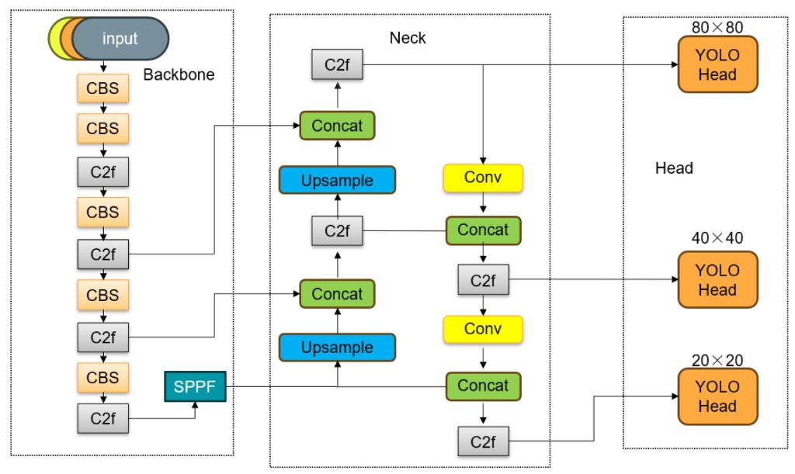
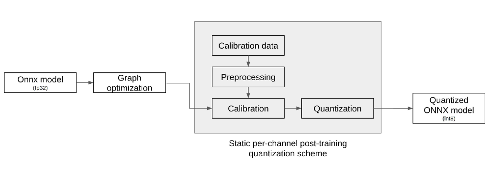
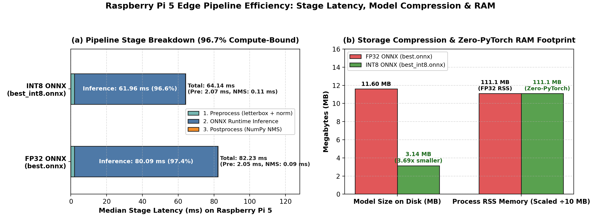
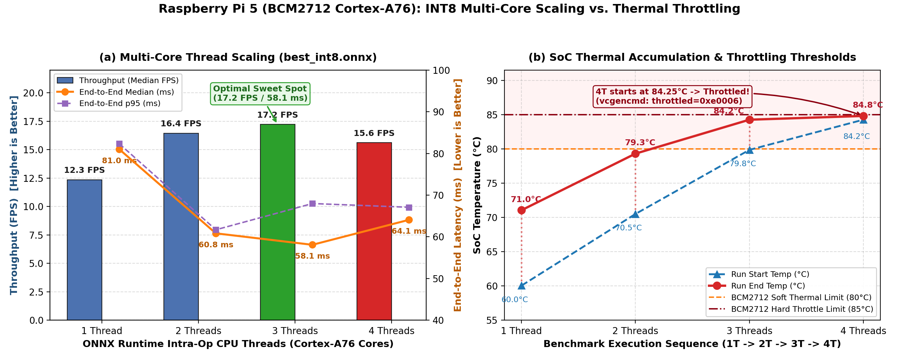
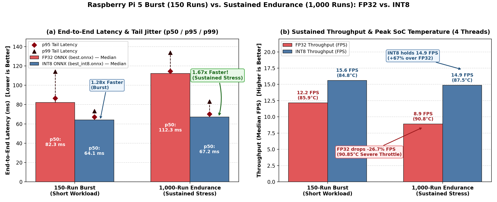
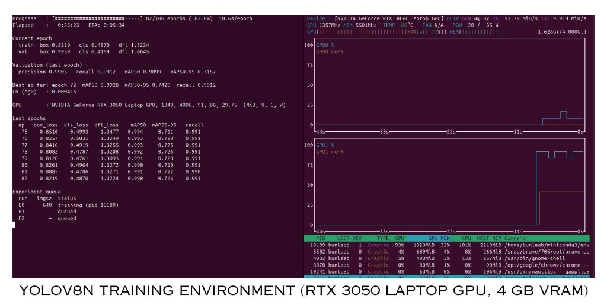
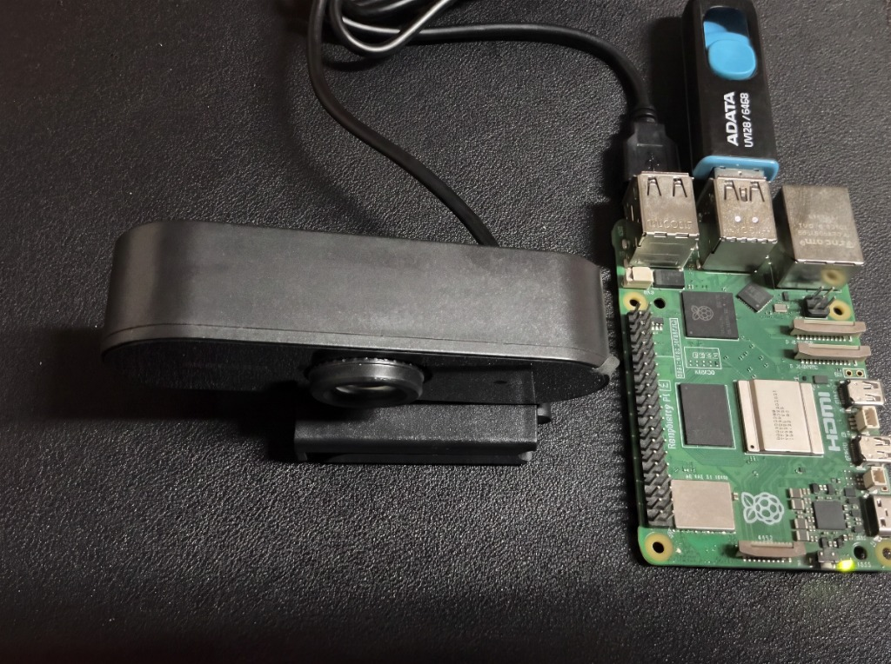
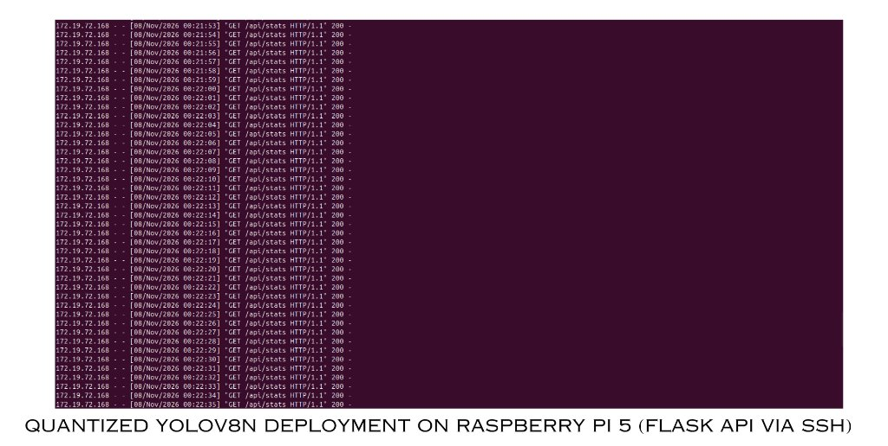
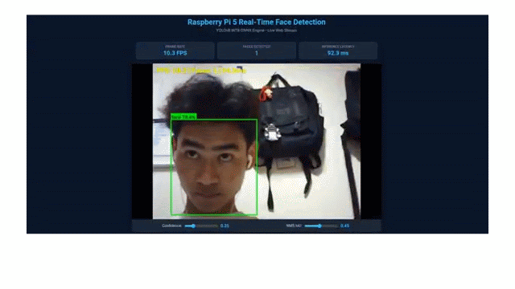

# INT8 Post-Training Quantization of YOLOv8n for Face Detection on Raspberry Pi 5

**Author:** Bunleab · **Date:** November 2026  
**Setup & Execution Guide:** See [`docs/technical_report.md`](docs/technical_report.md) for environment setup and how to run every code file.

## Abstract

We deploy a single-class YOLOv8n face detector (416×416) on a Raspberry Pi 5 (BCM2712, 4× Cortex-A76) with ONNX Runtime and Conv-only static INT8 PTQ (QDQ, MinMax, 300 calibration images). On a leakage-free test split (114 images), INT8 keeps mAP@0.5:0.95 at 0.6549 (FP32: 0.6541), shrinks the model 3.69× (11.60 → 3.14 MB), and cuts median end-to-end latency from 82.25 to 64.08 ms (1.28×; 12.2 → 15.6 FPS), peaking at 17.2 FPS with three threads. All runs were thermally throttled (`throttled=0xe0006`, up to 90.85 °C); a 1,000-run test shows a 1.67× gap that is partly confounded by heat carry-over. Power and CPU utilisation were not measured.

---

## 1. Introduction

YOLOv8n is the nano variant of the Ultralytics YOLOv8 family [1]: an anchor-free, single-stage detector (≈3.2 M parameters on COCO, ≈3.0 M for one class; ≈8.7 GFLOPs at 640²) with a convolution-dominated graph that exports cleanly to ONNX.

The Raspberry Pi 5 has limited shared RAM (4/8 GB), no GPU/NPU path for ONNX Runtime, a thermal envelope that throttles the ARM clock near 85 °C without active cooling, and a tight power budget. INT8 quantization cuts weight storage 4× and replaces FP32 arithmetic with integer kernels (e.g., NEON `sdot`/`udot`) [3].

**Objective:** quantify the accuracy–latency–size trade-off of INT8 PTQ for YOLOv8n on a Raspberry Pi 5.

---

## 2. Methodology

### 2.1 Architecture

YOLOv8n initialised from COCO weights and fine-tuned for one class (`Face`) at 416×416. Figure 1 shows the backbone (CBS/C2f/SPPF), PAN neck (upsample/concat/C2f), and three decoupled heads. The figure is drawn for 640×640 input (80/40/20 grids); at our 416×416 input the grids are 52×52, 26×26, and 13×13.

*Figure 1. YOLOv8 backbone, neck, and head (640×640 input shown).*

### 2.2 INT8 Post-Training Quantization

Figure 2 shows the static PTQ flow: FP32 ONNX → graph optimisation → preprocessing of calibration data → calibration → quantization → INT8 ONNX.

*Figure 2. Static PTQ workflow. The original diagram is labelled "per-channel"; this study used per-tensor weights (`per_channel=False`).*

**Affine quantization** [3, 4]. For range $[\alpha_{\min},\alpha_{\max}]$ and integer range $[q_{\min},q_{\max}]$:

$$
q = \text{clip}\left(\text{round}\left(\frac{x}{s}\right) + z, q_{\min}, q_{\max}\right), \quad
\hat{x} = s(q - z), \quad
s = \frac{\alpha_{\max} - \alpha_{\min}}{q_{\max} - q_{\min}}, \quad
z = \text{clip}\left(\text{round}\left(q_{\min} - \frac{\alpha_{\min}}{s}\right), q_{\min}, q_{\max}\right)
$$

Weights are symmetric ($z_w=0$, $s_w=\max|w|/127$).

**MinMax calibration** over the calibration set $\mathcal{C}$ ($|\mathcal{C}|=300$):

$$
\alpha_{\min}=\min_{x\in\mathcal{C}}\min(x),\qquad \alpha_{\max}=\max_{x\in\mathcal{C}}\max(x)
$$

**Error.** Inside the range $|x-\hat{x}|\le s/2$ and, for uniform rounding error, $\mathbb{E}[(x-\hat{x})^2]=s^2/12$; outliers widen the range and enlarge $s$.

**Integer convolution.** With INT32 accumulator $A_j = \sum_k (q_{x,k} - z_x) q_{w,jk}$:

$$
y_j \approx s_x s_w A_j, \qquad q_{y,j} = \text{clip}\left(\text{round}(M A_j) + z_y, q_{\min}, q_{\max}\right), \quad M = \frac{s_x s_w}{s_y}
$$

| Setting | Value |
|---|---|
| Framework | ONNX Runtime `quantize_static`, QDQ |
| Calibration | MinMax, 300 images (seed 42; 186 train + 114 valid; 0 test/OOD) |
| Quantized ops | `Conv` only; DFL/`Sub`/`Mul`/`Sigmoid`/`Concat` decode stays FP32 |
| Precision | Weights `QInt8` (symmetric), activations `QUInt8`, per-tensor |

Keeping the DFL decode in FP32 protects box localisation, because the Distribution Focal Loss head [2] takes expectations over softmax bins that are sensitive to quantization noise.

### 2.3 Data, metrics, and setup

- **Dataset:** Roboflow *Face-Detection v2*, 2,173 images (416×416). A dHash audit found 40 clusters leaking across splits; after cluster-aware deduplication: **907 train / 114 val / 114 test**, zero overlap, seed 42, 99.6 % large faces. Default Ultralytics online augmentation. Five OOD crowd images are used for stress testing only.
- **Metrics:** mAP@0.5, mAP@0.5:0.95 where $\mathrm{mAP} = \frac{1}{10}\sum_{t \in T} \mathrm{AP}$, precision, recall; latency (median, p95, p99), $\mathrm{FPS} = 1000 / L_{\text{ms}}$, speed-up $S = L_{\mathrm{FP32}} / L_{\mathrm{INT8}}$, model size, peak RSS, SoC temperature and throttle flags. **Not measured:** power and CPU utilisation.
- **Hardware / software (Pi):** Raspberry Pi 5 Model B Rev 1.1, aarch64, Linux 6.18.60+rpt-rpi-2712, Python 3.13.5, ONNX Runtime 1.31.1 (`CPUExecutionProvider`, `ORT_ENABLE_ALL`), OpenCV 5.0.0, NumPy 2.5.4; no PyTorch. Training host: RTX 3050 Laptop, PyTorch 2.13.0, Ultralytics 8.4.162. Cooler and RAM size were not recorded.
- **Reproducibility:** seed 42, `deterministic=True`, `amp=False`, batch 4, patience 20 (run E1, 47 epochs). Pi benchmark: 640×480 frames → letterbox 416, conf 0.25, IoU 0.45; sweep 1–4 threads (30 warm-up + 150 runs); endurance 4 threads (50 warm-up + 1,000 runs). Scripts: `scripts/quantize_ptq.py`, `pi/bench_pi.py`, `scripts/plot_pi_benchmarks.py`; data in `reports/pi_benchmark*.json`.

---

## 3. Results

### 3.1 Accuracy (frozen test split, 114 faces)

| Metric | FP32 | INT8 | Δ |
|---|---|---|---|
| mAP@0.5 | 0.9950 | 0.9893 | −0.0057 |
| mAP@0.5:0.95 | 0.6541 | 0.6549 | +0.0008 |
| Precision | 0.9993 | 0.9912 | −0.0081 |
| Recall | 0.9825 | 0.9912 | +0.0087 |

### 3.2 Raspberry Pi 5 latency

| Metric | FP32 burst | INT8 burst | FP32 sustained | INT8 sustained |
|---|---|---|---|---|
| Runs / threads | 150 / 4 | 150 / 4 | 1,000 / 4 | 1,000 / 4 |
| Model size | 11.60 MB | 3.14 MB | — | — |
| Inference median | 80.09 ms | 61.96 ms | 109.63 ms | 64.93 ms |
| End-to-end median | 82.25 ms | 64.08 ms | 112.27 ms | 67.22 ms |
| p95 / p99 | 86.53 / 114.04 ms | 67.09 / 73.30 ms | 114.44 / 133.66 ms | 70.24 / 83.17 ms |
| Median FPS | 12.2 | 15.6 | 8.9 | 14.9 |
| Temp start → end | 85.35 → 85.90 °C | 84.25 → 84.80 °C | 86.45 → 90.85 °C | 72.70 → 87.55 °C |

INT8 stage breakdown (burst): preprocess 2.07 ms (3.2 %), inference 61.96 ms (96.7 %), postprocess 0.11 ms (0.2 %). Peak process RSS was 111–116 MB, a process-wide figure identical for both models.

*Figure 3. Stage latency, model compression, and RSS.*

### 3.3 INT8 thread scaling (150 runs)

| Threads | End-to-end median (ms) | p95 (ms) | FPS | Scaling | Temp start → end (°C) |
|---|---|---|---|---|---|
| 1 | 81.00 | 82.32 | 12.3 | 1.00× | 60.05 → 71.05 |
| 2 | 60.84 | 61.70 | 16.4 | 1.33× | 70.50 → 79.30 |
| 3 | 58.09 | 67.98 | **17.2** | 1.39× | 79.85 → 84.25 |
| 4 | 64.08 | 67.09 | 15.6 | 1.26× | 84.25 → 84.80 |

*Figure 4. (a) Throughput and latency vs. threads; (b) SoC temperature vs. throttle thresholds.*

*Figure 5. (a) p50/p95/p99 latency; (b) throughput and end temperature (FP32 ran second in the 1,000-run test).*

**Highlights.** Best Pi throughput: 17.2 FPS (INT8, 3 threads). Largest accuracy change: −0.0057 mAP@0.5 and −0.0081 precision (mAP@0.5:0.95 unchanged). Weight storage saved: 8.46 MB. On the x86_64 reference (i5-12450H) INT8 is 1.32× faster (12.94 → 9.78 ms).

---

## 4. Experimental Setup and Deployment Demonstration

### 4.1 Training environment

The model was fine-tuned on an NVIDIA GeForce RTX 3050 Laptop GPU (4 GB VRAM). Figure 6 is a monitor snapshot taken during the 640×640 baseline run (E0, epoch 82/100, ≈18.6 s/epoch; GPU ≈94 % utilised, ≈1.6 GiB VRAM, ≈86 °C, 28/35 W). The champion 416×416 run (E1) is not shown.

*Figure 6. YOLOv8n training monitor (RTX 3050 Laptop GPU, 4 GB VRAM), E0 baseline run.*

### 4.2 Raspberry Pi 5 hardware

Figure 7 shows the deployment board: a Raspberry Pi 5 with a USB webcam and a USB flash drive attached. No heatsink or fan is visible on the SoC in this photo, which is consistent with the temperatures in §3 (passive cooling); the cooler and RAM size were not otherwise recorded.

*Figure 7. Raspberry Pi 5 with USB webcam.*

### 4.3 Serving and live demonstration

The quantized model is served by a Flask application (`pi/app_web.py`) that streams annotated frames to a browser and exposes telemetry at `/api/stats`. Figure 8 shows the server log during an SSH session: the browser polls `/api/stats` about once per second and every request returns HTTP 200. Figure 9 shows the web interface with live detection (confidence 0.25, NMS IoU 0.45).

*Figure 8. Quantized YOLOv8n on Raspberry Pi 5: Flask `/api/stats` log over SSH.*

*Figure 9. Live web interface demonstration on Raspberry Pi 5 (41-frame animated capture showing real-time 10.3 FPS stream and 92.3 ms inference latency).*

**Note.** The 10.3 FPS / 92.3 ms in Figure 9 is a single frame from the live pipeline (camera capture, JPEG streaming, and telemetry running concurrently; thread setting not recorded). It is not comparable to the offline benchmark in §3 (15.6 FPS, 64.08 ms end-to-end), which cycles stored frames without camera or streaming overhead.

---

## 5. Discussion

**Trade-offs.** Accuracy cost is at most 0.81 pt (mAP@0.5:0.95 unchanged), size falls 3.69× and burst latency 1.28×. With 114 faces one detection moves recall by 0.88 pt, so sub-1-pt differences are within noise. The size ratio is below 4× because the head stays FP32 and the file stores scales and QDQ metadata. The measured inference speed-up $S_{\text{inf}}=80.09/61.96=1.29$ implies, via Amdahl's law $S_{\text{inf}} = 1 / ((1 - f_q) + f_q / S_q)$,

$$
f_q \left(1 - \frac{1}{S_q}\right) = 1 - \frac{1}{S_{\text{inf}}} \approx 0.226
$$

so only part of inference time benefits from integer kernels (FP32 head, QDQ boundary operators, non-Conv ops). This is inferred from end-to-end timings; no per-operator profile was collected.

**Thermal throttling.** `throttled=0xe0006` means: bit 1 frequency capped, bit 2 currently throttled, bits 17–19 capping, throttling, and the soft temperature limit have occurred; bit 0 (under-voltage) is clear. All results are therefore throttled-state results. Two confounds apply: (i) the 4-thread run began at 84.25 °C after the 3-thread run, so heat carry-over, not only thread contention, may explain its drop; (ii) in the 1,000-run test INT8 ran first and FP32 started pre-heated (86.45 °C), inflating the 1.67× gap. The burst 1.28× is the cleaner estimate; a cooled, order-randomised repeat is needed.

**Edge scenarios.** Smart cameras, kiosks, and attendance at 0.3–2.5 m: suitable (15–17 FPS). Robotics: marginal (58–67 ms). Surveillance/crowds: unsuitable as trained (OOD mAP ≈ 0 for both models). Fanless enclosures: use three threads or add cooling.

**Layer-level notes.** Only `Conv` was quantized and the decode path kept in FP32 by design; no per-layer sensitivity sweep, per-channel weights, or FP16 fallback was used, so specific sensitive layers remain unidentified.

---

## 6. Conclusion

- INT8 PTQ preserved accuracy (mAP@0.5:0.95 0.6549 vs. 0.6541; worst drop −0.0057 mAP@0.5).
- The model shrank 3.69× (11.60 → 3.14 MB).
- On the Pi 5, INT8 was 1.28× faster in burst (15.6 vs. 12.2 FPS), peaking at 17.2 FPS with three threads; the sustained 1.67× is directional only.
- The pipeline is compute-bound (96.7 % inference) with ≈111–116 MB RSS.
- Thermals dominate: every run was throttled, so cooling and thread count matter as much as precision.

**Recommendation.** Use INT8 PTQ for close-range face detection on the Pi 5 when 15–17 FPS suffices and the board runs three threads or active cooling. It is not validated for small/crowded faces or >25 FPS requirements.

---

## 7. Limitations and Future Work

**Limitations.** One architecture, one class, near-homogeneous data (99.6 % large faces, 114 test images); 300 calibration images with MinMax only; no QAT, pruning, or FP16 baseline; power and CPU utilisation unmeasured; sequential benchmarking in a throttled state with unrecorded ambient temperature, cooler, and RAM size; benchmark frames contain no detections (NMS cost is a lower bound); no on-device accuracy re-evaluation.

**Future work.** (1) Thermally controlled, interleaved, repeated benchmarks with confidence intervals; (2) power metering and per-operator profiling; (3) QAT, pruning + PTQ, per-channel weights, Entropy/Percentile calibration, layer-wise sensitivity; (4) multi-objective search over accuracy, latency, energy, and temperature; (5) multi-scale data (WIDER FACE), other YOLO sizes, other Pi variants, and accelerators (AI HAT+ / Hailo-8L).

---

## References

[1] G. Jocher, A. Chaurasia, J. Qiu, "Ultralytics YOLOv8," 2023. https://github.com/ultralytics/ultralytics  
[2] X. Li *et al.*, "Generalized Focal Loss," *NeurIPS*, 2020.  
[3] B. Jacob *et al.*, "Quantization and Training of Neural Networks for Efficient Integer-Arithmetic-Only Inference," *CVPR*, 2018.  
[4] M. Nagel *et al.*, "A White Paper on Neural Network Quantization," arXiv:2106.08295, 2021.  
[5] ONNX Runtime, "Quantize ONNX models." https://onnxruntime.ai/docs/performance/model-optimizations/quantization.html
