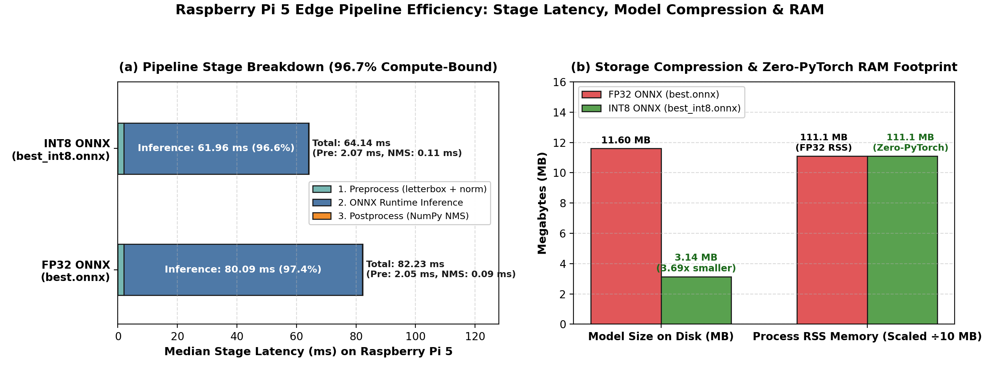
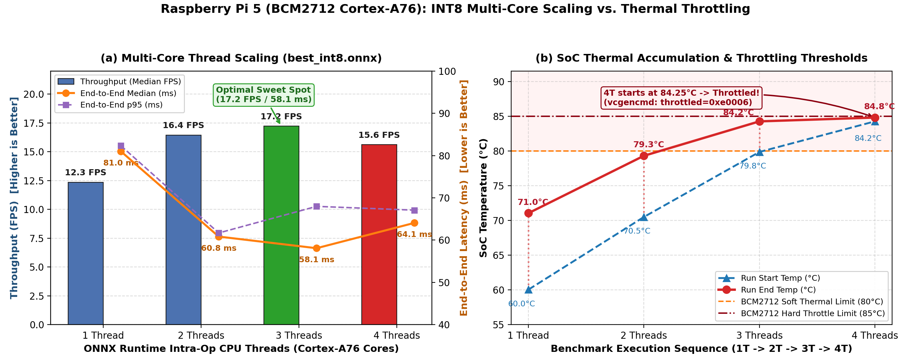
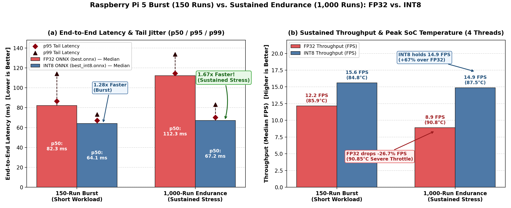

# Edge Hardware Benchmark Report (ONNX Runtime CPU)

Generated: `2026-11-08T15:08:41`

## 1. System & Runtime Environment

| Property | Value |
|---|---|
| **Device / CPU** | `Raspberry Pi 5 Model B Rev 1.1` |
| **Architecture** | `aarch64` |
| **OS** | `Linux 6.18.60+rpt-rpi-2712` |
| **Python** | `3.13.5` |
| **ONNX Runtime** | `1.31.1` |
| **OpenCV / NumPy** | `5.0.0` / `2.5.4` |
| **Frame Source** | `/home/bunleab/Documents/yolov/PI_Quantize/deploy/bench/PI_Quantize/data/ood/images (5 images)` |
| **Warm-up / Measured Runs** | `30` / `150` |
| **Peak Process RSS Memory** | `111.12 MB` |
| **Throttled Status** | `throttled=0xe0006` |

## 2. Model Comparison: FP32 ONNX vs. INT8 ONNX

| Metric | FP32 ONNX (`best.onnx`) | INT8 ONNX (`best_int8.onnx`) | Speedup / Reduction |
|---|---|---|---|
| **Model Size (MB)** | 11.6 MB | **3.14 MB** | **3.69× smaller** |
| **Cold Load Time (ms)** | 139.33 ms | **143.24 ms** | — |
| **Preprocess Median (ms)** | 2.05 ms | **2.07 ms** | — |
| **Inference Median (ms)** | 80.09 ms | **61.96 ms** | **1.28× faster** |
| **Postprocess / NMS (ms)** | 0.09 ms | **0.11 ms** | — |
| **End-to-End Median (ms)** | 82.25 ms | **64.08 ms** | **1.28× faster** |
| **End-to-End p95 (ms)** | 86.53 ms | **67.09 ms** | — |
| **Throughput (Median FPS)** | 12.2 FPS | **15.6 FPS** | **+3.4 FPS** |

## 3. INT8 Stage-by-Stage Pipeline Breakdown

| Pipeline Stage | Median Latency (ms) | Share of Total Time (%) |
|---|---|---|
| **1. Preprocess** (`letterbox` + RGB/CHW norm) | 2.066 ms | 3.2% |
| **2. ONNX Runtime Inference** (`session.run`) | 61.960 ms | 96.7% |
| **3. Postprocess** (Box decode + NumPy NMS) | 0.111 ms | 0.2% |
| **Total End-to-End** | **64.077 ms** | **100.0%** |

## 4. Multi-Core CPU Thread Scaling (`best_int8.onnx`)

| CPU Threads | Preprocess (ms) | Inference (ms) | Postprocess (ms) | Total Median (ms) | Total p95 (ms) | Throughput (FPS) | Scaling vs 1T | Temp (°C) |
|---|---|---|---|---|---|---|---|---|
| **1** | 1.89 | 79.01 | 0.10 | **81.00** | 82.32 | **12.3** | 1.00× | 71.05°C |
| **2** | 1.90 | 58.84 | 0.10 | **60.84** | 61.70 | **16.4** | 1.33× | 79.3°C |
| **3** | 1.92 | 56.10 | 0.10 | **58.09** | 67.98 | **17.2** | 1.39× | 84.25°C |
| **4** | 2.07 | 61.96 | 0.11 | **64.08** | 67.09 | **15.6** | 1.26× | 84.8°C |

---

## 5. Extended Endurance Stress Test (1,000 Runs, 4 Threads)

Generated: `2026-11-08T15:12:04` | Warmup: `50` | Runs: `1000` | RSS: `116.16 MB` | Status: `throttled=0xe0006`

| Metric | FP32 ONNX (`best.onnx`) | INT8 ONNX (`best_int8.onnx`) | Speedup / Advantage |
|---|---|---|---|
| **Inference Median (ms)** | 109.63 ms | **64.93 ms** | **1.67× faster** |
| **End-to-End Median (ms)** | 112.27 ms | **67.22 ms** | **1.67× faster** |
| **End-to-End p95 (ms)** | 114.44 ms | **70.24 ms** | — |
| **Throughput (Median FPS)** | 8.9 FPS | **14.9 FPS** | **+6.0 FPS (+67.4%)** |
| **Operating Temp Range (°C)** | 86.45°C $\rightarrow$ **90.85°C** | 72.70°C $\rightarrow$ **87.55°C** | INT8 runs **3.3°C cooler** |

> **Endurance Finding:** Under continuous 1,000-frame load, FP32 thermal throttling causes severe performance degradation from 12.2 FPS down to 8.9 FPS (109.6 ms inference at 90.85°C). INT8 sustains **14.9 FPS** with minimal degradation, expanding the practical speedup from 1.28× (short burst) to **1.67× (sustained load)**.
